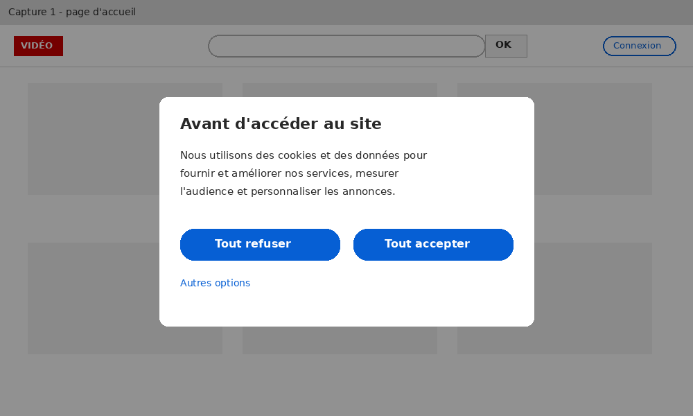
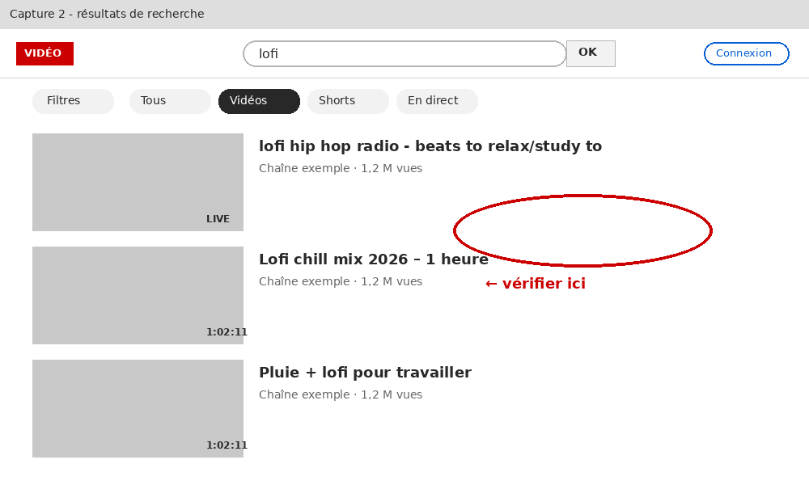
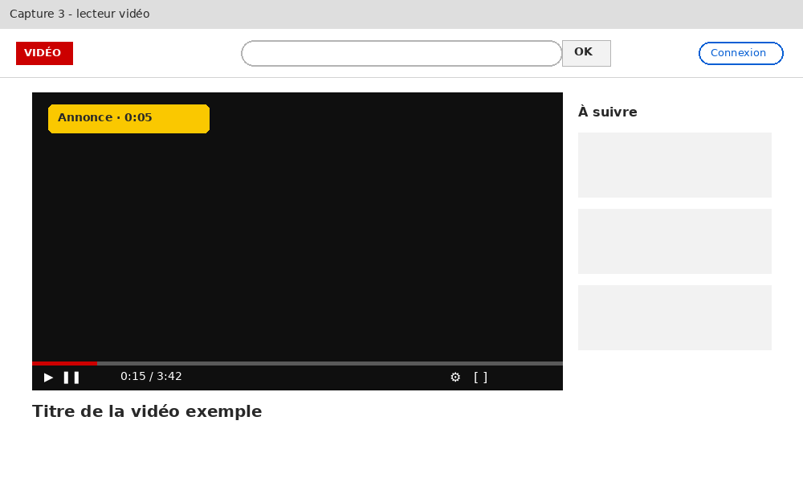
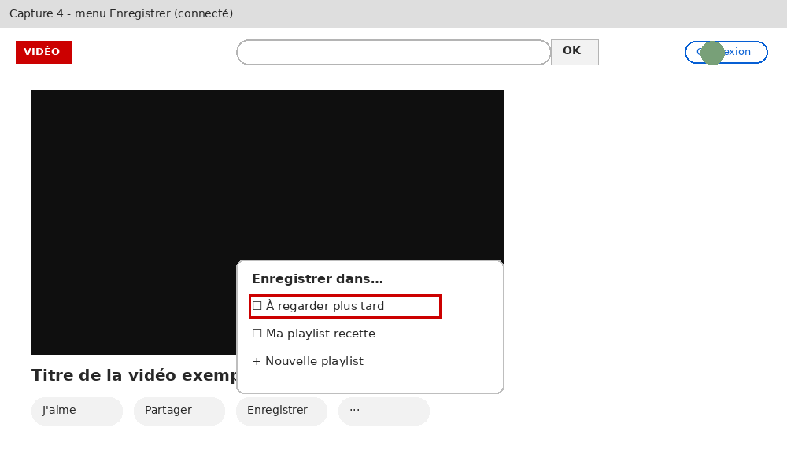

# Extraction de Recette_YouTube_v0.3.docx

## Cahier de recette – Site vidéo (YouTube)

Version 0.3 – rédigé par l'équipe recette – à relire

Environnement : https://www.youtube.com (prod, pas d'env de recette dispo). Navigateur : Chrome.

## SC-001 – Rechercher une vidéo

Objectif : vérifier que la recherche renvoie des résultats pertinents.

| Étape | Action | Résultat attendu |
|---|---|---|
| 1 | Ouvrir le site | La page d'accueil s'affiche |
| 2 | Valider les cookies | ∅ |
| 3 | Taper lofi dans la barre de recherche et valider | Les résultats s'affichent (voir capture 2) |
| 4 | Vérifier les résultats | C'est OK |

 — légende : « Capture 1 : bandeau cookies au premier accès »

Capture 1 : bandeau cookies au premier accès

 — légende : « Capture 2 : résultats attendus. Il doit y avoir au moins 10 vidéos. »

Capture 2 : résultats attendus. Il doit y avoir au moins 10 vidéos.

## SC-002 – Lire une vidéo

Faire une recherche comme dans SC-001 puis cliquer sur la première vidéo, elle doit se lancer toute seule. Mettre en pause puis passer en plein écran et revenir. Vérifier que la pub ne gêne pas la lecture. La vidéo doit avancer normalement (cf capture).

 — légende : « Capture 3 : lecteur après quelques secondes »

Capture 3 : lecteur après quelques secondes

## SC-003 – Ajouter une vidéo à « À regarder plus tard »

Prérequis :

- Avoir un compte connecté
- Compte de test : <IDENTIFIANT_2> / mdp : <MOT_DE_PASSE_1>

Étapes :

- Se connecter (bouton en haut à droite)
- Ouvrir une vidéo au hasard
- Cliquer sur Enregistrer puis cocher la bonne case (voir capture 4)
- Aller dans la bibliothèque, la vidéo doit y être

 — légende : « Capture 4 : menu Enregistrer »

Capture 4 : menu Enregistrer

NB : penser à supprimer la vidéo de la liste à la fin sinon le test suivant plante.

